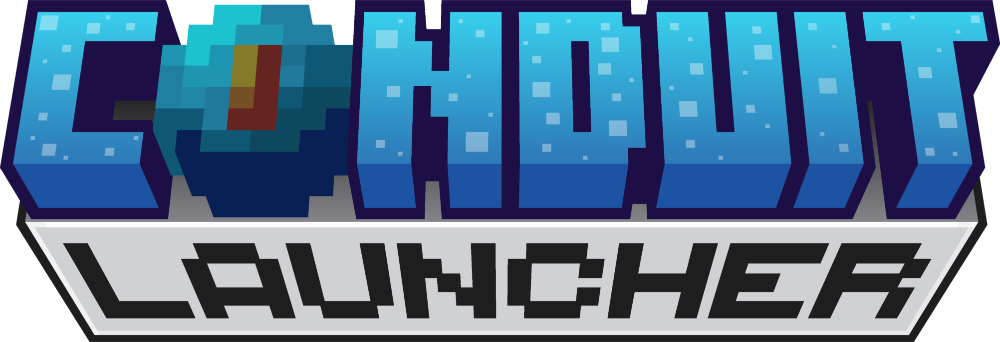

<p align="center">
  
</p>

<h1 align="center">Conduit Launcher</h1>

<p align="center">
  A windowless Windows x64 launcher for Minecraft Bedrock Edition and Conduit Client.
</p>

<div align="center">
  <a href="https://discord.gg/bestack">
    
  </a>
  <a href="https://github.com/Conduit-BE/Launcher/stargazers">
    
  </a>
</div>

## Quick start

1. Download `ConduitLauncher.exe` from the [Launcher releases](https://github.com/Conduit-BE/Launcher/releases).
2. Run the executable. The launcher finds Minecraft, starts it, and injects Conduit Client.
3. If Minecraft fails to start or Conduit does not appear in-game, check `%LOCALAPPDATA%\ConduitClient\logs\launcher.log`.

## Launch options

Run these commands from the folder containing `ConduitLauncher.exe`.

| Command | Behavior |
| --- | --- |
| `.\ConduitLauncher.exe` | Detects a Minecraft installation automatically. |
| `.\ConduitLauncher.exe --levi` | Starts the default LeviLauncher instance, even when a Store or Xbox installation is available. |
| `.\ConduitLauncher.exe --levi 'Conduit - 1.26.60.5'` | Starts the named LeviLauncher instance. |
| `.\ConduitLauncher.exe 'C:\path\to\Minecraft.Windows.exe'` | Starts the specified Minecraft executable. |

For a portable LeviLauncher installation, place its EXE beside `ConduitLauncher.exe`. The launcher uses the LeviLauncher 1.1.0 CLI.

## How it works

The launcher reads `launcher.version` from `%LOCALAPPDATA%\ConduitClient\config.json` to choose which `ConduitClient.dll` to download from [Conduit Client releases](https://github.com/Conduit-BE/Client/releases).

```json
{
  "launcher": {
    "version": "latest"
  }
}
```

Use `latest` for the newest published release, including prereleases, or enter an exact release tag such as `v1.0.0-stable` to pin a version. If the setting is missing or invalid, the launcher falls back to `latest`.

In automatic mode, the launcher checks for `Minecraft.Windows.exe` beside itself, then looks for a registered Minecraft for Windows installation and searches `XboxGames` on fixed drives. If those checks find no game, it looks for LeviLauncher and starts its default instance.

## Compatibility and logs

Conduit Client checks the Minecraft build during initialization. Windows can report that the DLL loaded successfully even if Conduit declines to initialize on an unsupported build. Check the [Conduit Client releases](https://github.com/Conduit-BE/Client/releases) for supported Minecraft versions and distributions.

| Log | What to check |
| --- | --- |
| `%LOCALAPPDATA%\ConduitClient\logs\launcher.log` | DLL download, game detection, launch, and injection. |
| `%LOCALAPPDATA%\ConduitClient\logs\standalone.log` | Conduit Client startup and compatibility checks. |

## Build from source

On x64 Windows with .NET Framework 4.8, run:

```powershell
powershell.exe -NoProfile -File .\build.ps1
```

The build writes `dist\ConduitLauncher.exe`.